  

# 🧠 Awesome Prompt Management & Engineering

  
  
  
  

## 🚀 Curated Guide to Prompt Management, Prompt Engineering, Evaluation & LLMOps Platforms

**A Comprehensive Directory of Commercial SaaS Prompt Systems & Self-Hosted Open-Source Prompt Engineering Frameworks** 🌟

*Focused on prompt registries, version control, automated evaluations, regression testing, tracing, observability, red teaming, and agent workflows.*

**Last updated: October 2026** 📅

---

### 💡 Overview & SEO Guide

**Prompt Management & Engineering** has evolved from simple text crafting into a mission-critical discipline within modern **LLMOps (Large Language Model Operations)** and AI application development. Production AI software demands strict prompt versioning, automated regression evaluation, multi-model cost/latency benchmarking, collaboration workflows between engineers and domain experts, and end-to-end prompt observability.

This repository tracks the leading **commercial hosted SaaS platforms** and **open-source prompt engineering frameworks**, providing AI engineers, LLMOps practitioners, and technical leaders with transparent data on pricing, free tier limits, company scale, and GitHub community adoption.

---

## 📑 Table of Contents

- [🏢 Commercial SaaS & Hosted Platforms](#-commercial-saas--hosted-platforms)
- [🔓 Open-Source GitHub Projects](#-open-source-github-projects)
  - [🎛️ Full-Stack Prompt Management, Observability & Evaluation](#%EF%B8%8F-full-stack-prompt-management-observability--evaluation)
  - [🧪 Prompt Evaluation, Testing & Red Teaming](#-prompt-evaluation-testing--red-teaming)
  - [🧩 Prompt Optimization, Orchestration & Structured Output](#-prompt-optimization-orchestration--structured-output)
- [🤝 How to Contribute](#-how-to-contribute)
- [💖 Support & Sponsorship](#-support--sponsorship)
- [📈 Star History](#-star-history)
- [⚠️ Disclaimer](#%EF%B8%8F-disclaimer)

---

## 🏢 Commercial SaaS & Hosted Platforms

The prompt management and prompt engineering software market is estimated at **$2.4 billion in 2026** and projected to reach **$8.9 billion by 2031** (growing at a 29.8% CAGR). The sector is currently **moderately fragmented**, featuring cloud hyperscalers and CRM giants embedding prompt studios on one side, and agile, specialized AI engineering/LLMOps startups competing fiercely for developer mindshare on the other.

> [!NOTE]
> The table below is sorted in **descending order** by company size (valuation / market capitalization / revenue).

| Platform | Description & Key Strengths | Starting Pricing | Free Tier / Trial Limit | Company Size (Valuation / Market Cap / Revenue) |
| :--- | :--- | :--- | :--- | :--- |
| **[Salesforce Agentforce Prompt Builder](https://www.salesforce.com/agentforce/)** 🏢 | Enterprise prompt studio grounded in CRM data via Data Cloud, zero-copy architecture, dynamic merge fields, and built-in enterprise trust policies. | $125/user/month (Enterprise Edition CRM base license) | 30-day free trial (Full Agentforce developer sandbox access) | Market Cap: **$280 Billion** (Parent: Salesforce Inc.; Annual Rev: $38.0B) |
| **[Braintrust](https://www.braintrust.com/)** ⚡ | Enterprise-grade evaluation-driven prompt engineering and LLM development platform with prompt playgrounds, CI/CD evals, and dataset curation. | $249/month (Base Team tier; 5 seats included) | Free tier forever (Up to 1,000 evaluations/month, 2 seats, and 100K logs) | Valuation: **$500 Million** (Series A funded; Total Funding: $60M+) |
| **[Humanloop](https://humanloop.com/)** 🎯 | Collaborative prompt workspace bridging product managers and engineers with prompt CMS, human feedback collection, and fine-tuning datasets. | $399/month (Team tier; 5 team seats) | 14-day free trial (Full platform features, up to 100,000 log events) | Valuation: **$150 Million** (Y Combinator alumnus; Series A stage) |
| **[Langfuse Cloud](https://langfuse.com/)** 🔭 | Developer-first prompt management, LLM tracing, semantic caching, and evaluation platform with native SDKs and OpenTelemetry compliance. | $29/seat/month (Team cloud tier) | Free tier forever (50,000 traces/month, 2 team seats, unlimited prompt versions) | Valuation: **$80 Million** (Y Combinator alumnus; Backed by Lightspeed) |
| **[Helicone](https://www.helicone.ai/)** ⚡ | Ultra-low latency LLM proxy, prompt template repository, cost observability, cache management, and user rate-limiting engine. | $50/month (Growth tier; 2M logged requests) | Free tier forever (100,000 requests/month, 3 seats, full prompt versioning) | Valuation: **$60 Million** (Y Combinator alumnus; Seed stage) |
| **[PromptLayer](https://promptlayer.com/)** 📜 | The pioneering prompt management system featuring visual prompt versioning, backtesting suites, collaboration workspaces, and API registry. | $40/user/month (Starter tier) | Free tier forever (1,000 prompt requests/month, 1 user seat) | Valuation: **$50 Million** (Seed funded; Premier early LLMOps pioneer) |
| **[HoneyHive](https://www.honeyhive.ai/)** 🐝 | AI evaluation and prompt observability platform specialized for building, testing, evaluating, and monitoring enterprise LLM agents. | $50/month (Developer tier) | 14-day free trial (Full agent evaluation suite, up to 50,000 traces) | Valuation: **$40 Million** (Seed funded; Supported by leading AI angels) |
| **[Agenta Cloud](https://agenta.ai/)** 🧪 | Developer-centric playground for prompt engineering, automated prompt parameter optimization, and regression testing with custom evaluators. | $20/user/month (Pro managed tier) | Free tier forever (1 user, 10,000 evaluation rows/month, self-hosted unlimited) | Valuation: **$25 Million** (Seed stage; Strong open-source developer base) |
| **[Pezzo Cloud](https://www.pezzo.ai/)** 🧩 | Serverless prompt engineering workspace offering prompt caching, rollback capabilities, and instant API deployment without redeploying code. | $19/user/month (Team tier) | Free tier forever (10,000 requests/month, 1 project, community support) | Valuation: **$15 Million** (Seed stage open-core startup) |

---

## 🔓 Open-Source GitHub Projects

The open-source ecosystem provides powerful tools for prompt management, programmatic prompt optimization, security red teaming, and systematic evaluation. Projects are listed below sorted in **descending order by GitHub Stars Count**.

---

### 🎛️ Full-Stack Prompt Management, Observability & Evaluation

- **[Dify](https://github.com/langgenius/dify)**  🌟
  **Production-ready LLM application development platform**, Apache-2.0 licensed. Combines prompt orchestration, prompt visual engineering, agent workflows, RAG pipeline construction, and model management into a single intuitive interface. **Best for end-to-end visual prompt engineering and autonomous agents.**

- **[LiteLLM](https://github.com/BerriAI/litellm)**  🌟
  **Universal proxy to call 100+ LLM APIs using OpenAI format**, MIT licensed. Features prompt templating, prompt injection shields, load balancing, cost tracking, and fallbacks across Azure, Anthropic, Bedrock, and local models. **Best for multi-provider prompt routing and gateway proxying.**

- **[Langfuse](https://github.com/langfuse/langfuse)**  🌟
  **Open-source LLM engineering platform**, MIT/EE licensed. Features centralized prompt management with semantic versioning, programmatic prompt fetching via SDKs, trace visualizations, dataset evaluation, and playground experimentation. **Best for self-hosted enterprise prompt registries and LLM observability.**

- **[Microsoft Prompt Flow](https://github.com/microsoft/promptflow)**  🌟
  **Suite of development tools for LLM-based applications**, MIT licensed. Streamlines end-to-end prompt engineering from prototyping, experimenting, iterative testing, and quality evaluations to cloud deployment. **Best for engineering multi-step prompt pipelines and evaluation flows.**

- **[Arize Phoenix](https://github.com/Arize-ai/phoenix)**  🌟
  **AI observability and evaluation workbench**, Apache-2.0 licensed. Provides prompt tracing, evaluation benchmark runners, LLM performance diagnostics, and automated drift detection. **Best for prompt diagnostics and observability.**

- **[Helicone](https://github.com/Helicone/helicone)**  🌟
  **Open-source LLM proxy and prompt monitoring platform**, Apache-2.0 licensed. Built for low-overhead latency tracking, prompt experimentation, automated semantic caching, rate limiting, and cost optimization. **Best for real-time prompt telemetry and cache acceleration.**

- **[Agenta](https://github.com/Agenta-AI/agenta)**  🌟
  **Developer-first prompt engineering and LLMOps suite**, Apache-2.0 licensed. Empowers teams to quickly iterate on prompts, test edge cases, configure custom evaluators, and deploy prompts as production microservices. **Best for team collaboration on prompt variants.**

- **[Pezzo](https://github.com/pezzolabs/pezzo)**  🌟
  **Cloud-native open-source prompt management framework**, Apache-2.0 licensed. Offers prompt versioning, instant hot-reloading in client apps without redeployments, execution metrics, and team collaboration. **Best for fast prompt iterations without code releases.**

---

### 🧪 Prompt Evaluation, Testing & Red Teaming

- **[Promptfoo](https://github.com/promptfoo/promptfoo)**  🌟
  **CLI and library for evaluating LLM prompt quality and security**, MIT licensed. Run automated prompt tests against predefined assertions, benchmark model outputs across providers, run red teaming attacks, and integrate prompt regression tests into GitHub Actions CI/CD. **Best for automated prompt testing, red teaming, and CI/CD quality gates.**

- **[DeepEval](https://github.com/confident-ai/deepeval)**  🌟
  **Unit testing framework for LLMs and prompt outputs**, Apache-2.0 licensed. Provides 14+ production-ready metrics including hallucination, answer relevancy, G-Eval, bias, and toxicity checks for prompt regression benchmarking. **Best for Pytest-native prompt unit testing.**

- **[Ragas](https://github.com/explodinggradients/ragas)**  🌟
  **Automated evaluation framework for RAG and prompt pipelines**, Apache-2.0 licensed. Evaluates prompt effectiveness in retrieving context, generating faithful answers, and retaining semantic correctness. **Best for RAG prompt tuning and retrieval-grounded evaluations.**

- **[Autoevals (by Braintrust)](https://github.com/braintrustdata/autoevals)**  🌟
  **Lightweight library for evaluating LLM prompts and models**, MIT licensed. Includes off-the-shelf evaluators for Battle (LLM-as-a-judge), SQL generation accuracy, factual consistency, and Levenshtein distance. **Best for plug-and-play programmatic prompt scoring.**

---

### 🧩 Prompt Optimization, Orchestration & Structured Output

- **[DSPy](https://github.com/stanfordnlp/dspy)**  🌟
  **Framework for algorithmically optimizing LLM prompts and weights**, MIT licensed. Replaces brittle handcrafted prompting with programmatic modules and automated optimizers (MIPROv2, BootstrapFewShot) that automatically synthesize few-shot prompts. **Best for automated algorithmic prompt optimization and compilation.**

- **[Haystack](https://github.com/deepset-ai/haystack)**  🌟
  **End-to-end LLM orchestration framework**, Apache-2.0 licensed. Features modular prompt builders, Jinja2 dynamic templating, pipeline validation, and seamless integrations with modern vector search engines. **Best for modular production prompt pipelines.**

- **[Guidance](https://github.com/guidance-ai/guidance)**  🌟
  **Constrained prompting language by Microsoft & community**, MIT licensed. Interleaves generation, prompting, and token-level constraints to guarantee regex, CFG grammar, and valid structured JSON execution with maximum inference throughput. **Best for structured output generation and token-level prompt control.**

- **[Outlines](https://github.com/dottxt-ai/outlines)**  🌟
  **Structured text generation and prompt engineering engine**, Apache-2.0 licensed. Guarantees that LLM outputs match Pydantic schemas, regular expressions, or JSON schemas without prompt retry loops. **Best for schema-constrained prompt responses.**

- **[OpenPrompt](https://github.com/thunlp/OpenPrompt)**  🌟
  **Open-source framework for prompt-learning research**, Apache-2.0 licensed. Allows researchers and engineers to deploy prompt templates, verbalizers, and soft prompt tuning methods across pretrained foundation models. **Best for academic research and prompt-tuning algorithms.**

- **[Microsoft Prompt Engine](https://github.com/microsoft/prompt-engine)**  🌟
  **Lightweight library for creating and parsing prompts for Large Language Models**, MIT licensed. Specialized utility helpers for formatting natural language instructions, examples, and dialogues for LLMs. **Best for lightweight TypeScript/JavaScript prompt construction.**

---

## 🤝 How to Contribute

1. Fork this repository 🍴
2. Add or update entries in [README.md](file:///C:/Users/hp/Documents/Projects/Awesome-Prompt-Management-Engineering/README.md) keeping formatting strictly consistent with existing tables and bullet lists.
3. Ensure starting pricing, free tier limits, company sizes, and repository links are accurate and up to date.
4. Submit a Pull Request (PR) detailing your proposed updates.

---

## 💖 Support & Sponsorship

If you find this Prompt Management & Engineering directory helpful in building your AI stack:
- ⭐ **Star** this repository to help others discover it!
- 🔀 **Fork** and share with your LLMOps and AI engineering teams.
- ☕ **Buy me a coffee / Sponsor**: Support ongoing maintenance on the [GitHub Sponsor Dashboard](https://github.com/sponsors/ishandutta2007).

---

##  Star History

---

## ⚠️ Disclaimer

- This directory is **community-curated** for educational, technical, and architectural evaluation purposes.
- Commercial prices, free tier quotas, and corporate valuations change periodically. Always verify exact parameters on respective vendor websites.
- Self-hosting open-source prompt solutions requires proper infrastructure management, data isolation, and credential security.

---

  <b>Made with ❤️ for AI engineers, prompt designers, and LLMOps specialists worldwide.</b>

